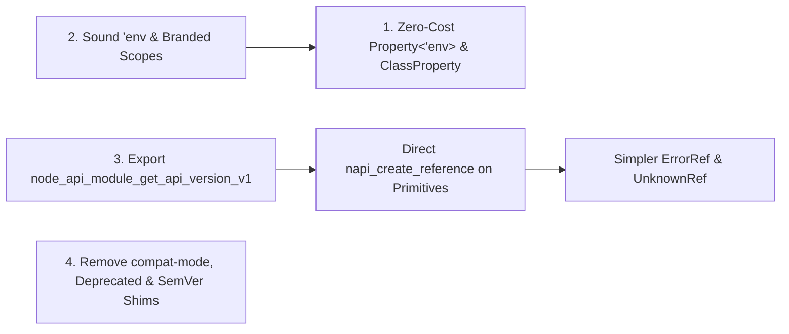
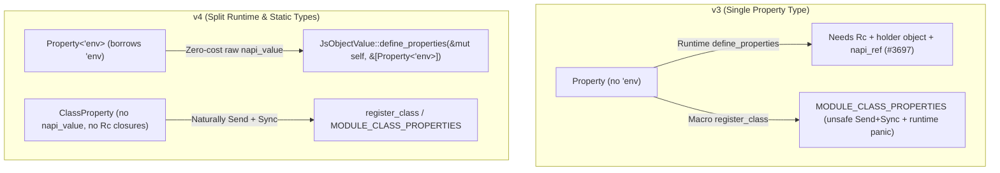
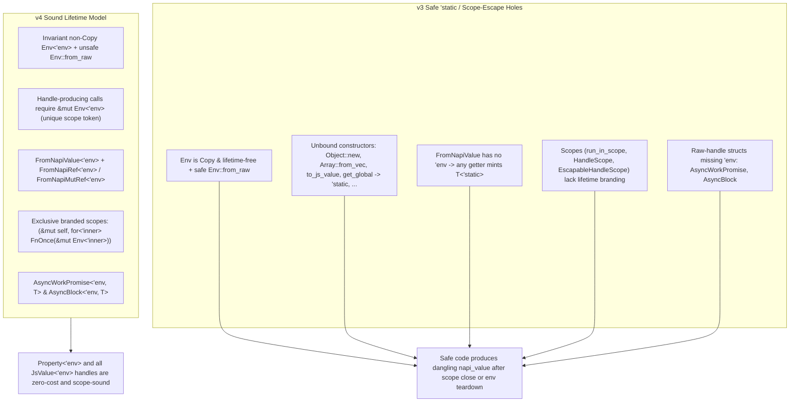
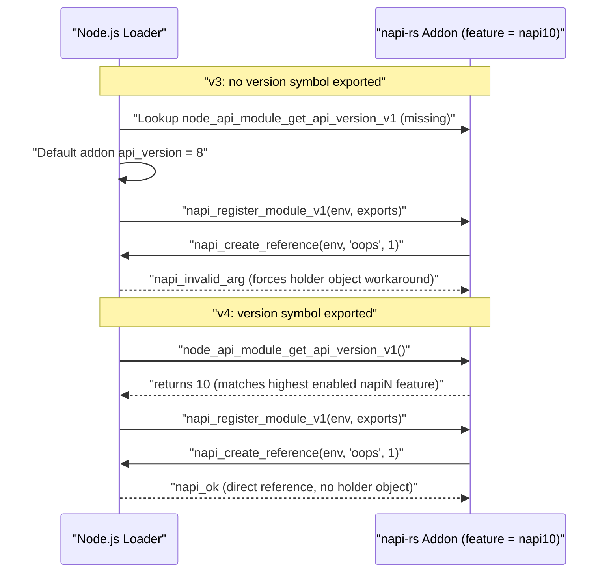

# `napi-rs` v4 Breaking Changes

This document tracks the planned breaking changes for `napi-rs` v4. Every item below is tied to verified code in the repository today and lists the exact symbols, current holes or shims, and target v4 design.

## Roadmap & Dependencies

Several v4 items depend on one another: zero-cost `Property<'env>` is only sound once `'env` lifetimes and handle scopes are enforced, and cleaner JS references depend on negotiating the Node-API version at module load.



| Area                                                                                                  | Main Breaking Change                                                                                                                                                   | Key Win                                                                                                                        |
| ----------------------------------------------------------------------------------------------------- | ---------------------------------------------------------------------------------------------------------------------------------------------------------------------- | ------------------------------------------------------------------------------------------------------------------------------ |
| [1. `Property<'env>` & `ClassProperty`](#1-propertyenv--static-classproperty-split)                   | Add `'env` to `Property`; split out static `ClassProperty`; drop dead `PropertyClosures` fields; make `with_data` `unsafe`                                             | Zero-cost property descriptors without `napi_ref` / holder objects; compile-time `Send + Sync` class registration              |
| [2. Sound `'env` & Handle Scopes](#2-sound-env-lifetime--handle-scope-model)                          | Make `Env<'env>` lifetime-branded and non-`Copy` (or scoped); parameterize `FromNapiValue<'env>`; brand handle scopes; add `'env` to `AsyncWorkPromise` & `AsyncBlock` | Prevents safe `'static` minting and dangling `napi_value` handles across scopes or envs                                        |
| [3. Node-API Version Negotiation](#3-node-api-version-negotiation-node_api_module_get_api_version_v1) | Export `node_api_module_get_api_version_v1` matching the enabled `napiN` feature                                                                                       | Unlocks Node-API 10+ primitive `napi_create_reference`; removes holder-object indirection in `ErrorRef` and fixes `UnknownRef` |
| [4. Deprecations & SemVer Cleanup](#4-deprecated-compat-mode-and-semver-held-items)                   | Remove `compat-mode`, deprecated `2.17` / `3.0` APIs, and v2/v3 compatibility shims                                                                                    | Smaller public surface, fewer unsafe/legacy paths, infallible `JsStringUtf8` getters                                           |

---

## 1. `Property<'env>` & Static `ClassProperty` Split

### Problem in v3

In v3, `Property` ([`crates/napi/src/js_values/object_property.rs`](../crates/napi/src/js_values/object_property.rs#L316-L332)) has no `'env` lifetime, yet accepts JS values via three public methods:

- `Property::with_name` ([`object_property.rs:415`](../crates/napi/src/js_values/object_property.rs#L415-L420))
- `Property::with_value` ([`object_property.rs:488`](../crates/napi/src/js_values/object_property.rs#L488-L495)) (discards `'env` and returns `Self`, not `Result<Self>`)
- `Property::with_napi_value` ([`object_property.rs:497`](../crates/napi/src/js_values/object_property.rs#L497-L502))

To fix issue [#3697](https://github.com/napi-rs/napi-rs/issues/3697) without breaking SemVer, v3 retains those JS values at runtime via `Rc<RetainedValue>` ([`object_property.rs:22-33`](../crates/napi/src/js_values/object_property.rs#L22-L33)) backed by `napi_ref` (and a private holder object for primitives on Node-API < 10), checks environment identity on resolve, and defers `with_value` retention errors until `Property::raw`.

At the same time, `Property` is reused as the static registration type for `#[napi]` classes in `register_class` ([`crates/napi/src/bindgen_runtime/module_register.rs:696-725`](../crates/napi/src/bindgen_runtime/module_register.rs#L696-L725)) and `MODULE_CLASS_PROPERTIES` ([`module_register.rs:74-91,118`](../crates/napi/src/bindgen_runtime/module_register.rs#L74-L91)). Because `Property` can carry non-thread-safe `Rc<OwnedClosure>` and `Rc<RetainedValue>` fields, `ModuleClassProperty` relies on `unsafe impl Send + Sync` plus runtime `assert!` panics in `register_class` (`!prop.has_owned_closure()` and `!prop.has_js_value()`).

### Why v3 Cannot Use `Property<'env>`

Keeping v3 SemVer-compatible requires the runtime retention fix for #3697 (`Rc<RetainedValue>` backed by `napi_ref` + a private holder object for primitives):

1. Adding `'env` to `Property` breaks every user signature referencing `Property` (Rust has no default lifetime parameters) and breaks `register_class(..., props: Vec<Property>, ...)`.
2. Without Section 2's sound `'env` model, `Property<'env>` would still allow safe `Property<'static>` handles.
3. Without Section 3's Node-API version negotiation, `napi_create_reference` rejects primitive values in Node, requiring a private JS holder object (the same indirection `ErrorRef` uses in [`crates/napi/src/error.rs:477-506`](../crates/napi/src/error.rs#L477-L506)) plus `Rc` so `Property: Clone` still holds.

### v4 Design

Split `Property` into a zero-cost runtime descriptor tied to `'env` and a static, handle-free class descriptor:



### Specific Changes in `object_property.rs`

| Symbol                                               | Location                                                                                  | Current (v3)                                                                                                                         | Target (v4)                                                                                                                                                                                                                                               |
| ---------------------------------------------------- | ----------------------------------------------------------------------------------------- | ------------------------------------------------------------------------------------------------------------------------------------ | --------------------------------------------------------------------------------------------------------------------------------------------------------------------------------------------------------------------------------------------------------- |
| `Property`                                           | [`object_property.rs:316`](../crates/napi/src/js_values/object_property.rs#L316-L332)     | Lifetime-free `Property` retaining JS handles via `Rc<RetainedValue>` and reused for macro class registration                        | `Property<'env>` for runtime `define_properties` & `ClassInstance::assign_to_this_with_attributes`; separate `ClassProperty` (UTF-8 name, `SymbolKey`, C `Callback`s, `PropertyAttributes`, `is_ctor`) for `register_class` and `MODULE_CLASS_PROPERTIES` |
| `PropertyClosures::{setter_drop_fn, getter_drop_fn}` | [`object_property.rs:249-254`](../crates/napi/src/js_values/object_property.rs#L249-L254) | Dead public fields kept only to preserve struct layout (_"no longer used to drop the closure: the boxed callback data owns it now"_) | Remove both fields (or make `PropertyClosures` crate-private)                                                                                                                                                                                             |
| `Property::with_data`                                | [`object_property.rs:504-508`](../crates/napi/src/js_values/object_property.rs#L504-L508) | Safe `pub fn with_data(mut self, data: *mut c_void) -> Self` (`#[doc(hidden)]`); silently overrides closure data in `Property::raw`  | Make `unsafe fn with_data`, replace with a typed API, or remove from public API                                                                                                                                                                           |
| `Property::with_value`                               | [`object_property.rs:488-495`](../crates/napi/src/js_values/object_property.rs#L488-L495) | `pub fn with_value<'env, T: JsValue<'env>>(mut self, value: &T) -> Self` drops `'env` and defers retention errors to `Property::raw` | Bind `T: JsValue<'env>` to `Property<'env>` (and return `Result<Self>` if env validation or fallible conversion is added)                                                                                                                                 |
| `JsObjectValue::define_properties`                   | [`object.rs:467`](../crates/napi/src/bindgen_runtime/js_values/object.rs#L467)            | `fn define_properties(&mut self, properties: &[Property]) -> Result<()>`                                                             | `fn define_properties(&mut self, properties: &[Property<'env>]) -> Result<()>` so descriptors cannot outlive or mismatch the target object's `'env`                                                                                                       |

---

## 2. Sound `'env` Lifetime & Handle-Scope Model

> **Prerequisite for Section 1.** Zero-cost `Property<'env>` is only memory-safe if safe Rust cannot forge a `'static` handle or move a handle out of a closed `HandleScope`.

In v3, `'env` on `JsValue<'env>` types (`Object<'env>`, `Unknown<'env>`, `JsString<'env>`, etc.) is advisory. Multiple safe APIs allow minting an arbitrary `'env` (including `'static`) or escaping a closed handle scope:



### Concrete Audit of v3 Holes

#### 2.1 `Env` Has No Lifetime & `Env::from_raw` Is Safe

| Item             | Location                                                            | Issue in v3                                                                     | Target in v4                                                                                                                                                                                                                                                                                                                                                                                                                                                        |
| ---------------- | ------------------------------------------------------------------- | ------------------------------------------------------------------------------- | ------------------------------------------------------------------------------------------------------------------------------------------------------------------------------------------------------------------------------------------------------------------------------------------------------------------------------------------------------------------------------------------------------------------------------------------------------------------- |
| `pub struct Env` | [`crates/napi/src/env.rs:60,70`](../crates/napi/src/env.rs#L60-L76) | `#[derive(Clone, Copy)]`, no lifetime parameter, and safe `From<sys::napi_env>` | Non-`Copy` `Env<'env>` with invariant lifetime marker (`PhantomData<*mut &'env ()>`); remove `From<sys::napi_env>`                                                                                                                                                                                                                                                                                                                                                  |
| `Env::from_raw`  | [`crates/napi/src/env.rs:80`](../crates/napi/src/env.rs#L78-L82)    | Safe `pub fn from_raw(env: sys::napi_env) -> Self`                              | `pub unsafe fn from_raw<'env>(env: sys::napi_env) -> Env<'env>` — **safety contract:** `'env` must be a fresh, unique invariant brand not shared with any other live `napi_env` or outer/inner scope on this thread, and must not outlive that scope. Generated `#[napi]` entry points and callbacks enforce this by constructing `Env` through an HRTB scope helper (`for<'env> FnOnce(&mut Env<'env>)`), which yields a distinct, unnameable brand per invocation |

#### 2.2 Unbound Constructors & Hardcoded `'static` Lifetimes

Every method below returns a handle whose lifetime is not tied to the input `Env` (or is hardcoded to `'static`), letting callers pick `'static` in safe code. In v4, every handle-producing constructor takes `&mut Env<'env>` (matching Section 2.4's unique-capability rule):

| Symbol                                                   | Location                                                                                          | Current Signature (v3)                                                                          | Target Signature / Lifetime (v4)                                                      |
| -------------------------------------------------------- | ------------------------------------------------------------------------------------------------- | ----------------------------------------------------------------------------------------------- | ------------------------------------------------------------------------------------- |
| `Env::create_string_from_std`                            | [`env.rs:192`](../crates/napi/src/env.rs#L192-L194)                                               | `fn create_string_from_std<'env>(&self, s: String) -> Result<JsString<'env>>`                   | Take `&mut self` (`&mut Env<'env>`) and return `Result<JsString<'env>>`               |
| `Env::create_string_from_c_char`                         | [`env.rs:204`](../crates/napi/src/env.rs#L204-L212)                                               | `unsafe fn create_string_from_c_char<'env>(&self, ...) -> Result<JsString<'env>>`               | Take `&mut self` (`&mut Env<'env>`) and bind `'env`                                   |
| `Env::to_js_value`                                       | [`env.rs:1613`](../crates/napi/src/env.rs#L1613-L1621)                                            | `fn to_js_value<'env, T>(&self, node: &T) -> Result<Unknown<'env>>`                             | Take `&mut self` (`&mut Env<'env>`) and bind `'env`                                   |
| `Env::get_global`                                        | [`bindgen_runtime/env.rs:12`](../crates/napi/src/bindgen_runtime/env.rs#L12-L26)                  | `fn get_global(&self) -> Result<JsGlobal<'static>>`                                             | Take `&mut self` (`&mut Env<'env>`) and return `Result<JsGlobal<'env>>`               |
| `Object::from_raw`                                       | [`object.rs:800-811`](../crates/napi/src/bindgen_runtime/js_values/object.rs#L800-L811)           | Safe `fn from_raw(env: sys::napi_env, value: sys::napi_value) -> Self` on `impl Object<'_>`     | Make `unsafe` and tie lifetime to caller-proven `'env`                                |
| `Object::new`                                            | [`object.rs:814`](../crates/napi/src/bindgen_runtime/js_values/object.rs#L814-L831)               | `fn new(env: &Env) -> Result<Self>` on `impl Object<'_>`                                        | `fn new(env: &mut Env<'env>) -> Result<Object<'env>>`                                 |
| `Array::from_vec`, `from_ref_vec_string`, `from_ref_vec` | [`array.rs:167-202`](../crates/napi/src/bindgen_runtime/js_values/array.rs#L167-L203)             | `fn from_*(env: &Env, ...) -> Result<Self>` on `impl Array<'_>`                                 | Bind `Array<'env>` to `env: &mut Env<'env>`                                           |
| `BufferSlice::from_data`                                 | [`buffer.rs:112-116`](../crates/napi/src/bindgen_runtime/js_values/buffer.rs#L112-L116)           | `impl<'env> BufferSlice<'env> { pub fn from_data(env: &Env, ...) -> Result<Self> }`             | Take `env: &mut Env<'env>`                                                            |
| `ArrayBuffer::from_data`                                 | [`arraybuffer.rs:191-193`](../crates/napi/src/bindgen_runtime/js_values/arraybuffer.rs#L191-L193) | `impl<'env> ArrayBuffer<'env> { pub fn from_data(env: &Env, ...) -> Result<Self> }`             | Take `env: &mut Env<'env>`                                                            |
| `PromiseRaw::new`, `resolve`, `reject`                   | [`promise_raw.rs:57-100`](../crates/napi/src/bindgen_runtime/js_values/promise_raw.rs#L57-L101)   | Safe `PromiseRaw::new` with unbound `'_`; `resolve` / `reject` take `env: &Env` on `impl<'env>` | Make `new` `unsafe`; bind `resolve` / `reject` to `env: &mut Env<'env>`               |
| `Function::new_instance`                                 | [`function.rs:192`](../crates/napi/src/bindgen_runtime/js_values/function.rs#L192-L208)           | `fn new_instance<'a>(&self, args: Args) -> Result<Unknown<'a>>`                                 | Take `env: &mut Env<'env>` and return `Result<Unknown<'env>>` tied to `Env<'env>`     |
| `ReadableStream::new`                                    | [`stream/read.rs:433-437`](../crates/napi/src/bindgen_runtime/js_values/stream/read.rs#L433-L437) | `impl<T> ReadableStream<'_, T> { pub fn new(env: &Env, ...) -> Result<Self> }`                  | Bind `ReadableStream<'env, T>` to `env: &mut Env<'env>`                               |
| `Env::spawn_future_with_callback`                        | [`env.rs:1335-1356`](../crates/napi/src/env.rs#L1335-L1356)                                       | Transmutes `&Env` to `&'env Env` inside the async settlement callback                           | Use higher-ranked `for<'cb> FnOnce(&mut Env<'cb>, T) -> Result<V>`                    |
| `Env::get_instance_data`                                 | [`env.rs:1464`](../crates/napi/src/env.rs#L1464)                                                  | Returns `Result<Option<&'static mut T>>` (outlives env teardown and allows aliasing `&mut T`)   | Tie borrow to `&'env Env<'env>` (and use shared `&T` or explicit interior mutability) |

#### 2.3 `FromNapiValue` Lacks `'env`

Because `FromNapiValue` has no lifetime parameter ([`crates/napi/src/bindgen_runtime/js_values.rs:101-115`](../crates/napi/src/bindgen_runtime/js_values.rs#L101-L115)), every handle type implements it for an arbitrary lifetime:

- `impl FromNapiValue for Unknown<'_>` ([`js_values/unknown.rs:40`](../crates/napi/src/js_values/unknown.rs#L40))
- `impl FromNapiValue for Array<'_>` ([`array.rs:132`](../crates/napi/src/bindgen_runtime/js_values/array.rs#L132))
- `impl FromNapiValue for ArrayBuffer<'_>` ([`arraybuffer.rs:160`](../crates/napi/src/bindgen_runtime/js_values/arraybuffer.rs#L160))
- `impl FromNapiValue for PromiseRaw<'_, T>` ([`promise_raw.rs:51`](../crates/napi/src/bindgen_runtime/js_values/promise_raw.rs#L51))
- `impl FromNapiValue for Function<'_, Args, Return>` ([`function.rs:147`](../crates/napi/src/bindgen_runtime/js_values/function.rs#L147))

As a result, **every** safe generic getter or conversion bound by `T: FromNapiValue` can mint `Object<'static>` or `Unknown<'static>`:

- `FromNapiValue::from_unknown(value: Unknown) -> Result<Self>` ([`bindgen_runtime/js_values.rs:112`](../crates/napi/src/bindgen_runtime/js_values.rs#L112-L114))
- `Object::get` ([`object.rs:834`](../crates/napi/src/bindgen_runtime/js_values/object.rs#L834))
- `JsObjectValue::{get_property, get_property_unchecked, get_named_property, get_named_property_unchecked}` ([`object.rs:32,57,149,198`](../crates/napi/src/bindgen_runtime/js_values/object.rs#L32-L212))
- `Array::get` ([`array.rs:31`](../crates/napi/src/bindgen_runtime/js_values/array.rs#L31))
- `Env::run_script` ([`env.rs:1153`](../crates/napi/src/env.rs#L1153))
- `Function::{call, apply}` ([`function.rs:228,255`](../crates/napi/src/bindgen_runtime/js_values/function.rs#L228-L273))

Likewise, `FromNapiRef::from_napi_ref` and `FromNapiMutRef::from_napi_mut_ref` ([`bindgen_runtime/js_values.rs:117-142`](../crates/napi/src/bindgen_runtime/js_values.rs#L117-L142)) return `&'static Self` / `&'static mut Self`.

**v4 fix:** Parameterize `FromNapiValue<'env>` (and `FromNapiRef<'env>` / `FromNapiMutRef<'env>`):

- Owned Rust types (`i32`, `String`, `Vec<T>`, `Buffer`, etc.) implement `FromNapiValue<'_>` for all `'env`.
- Handle types implement `FromNapiValue<'env>` only for their own `'env` (`impl<'env> FromNapiValue<'env> for Object<'env>`).
- Getters on `Object<'env>`, `Array<'env>`, `Function<'env, ...>`, and `Env<'env>` require `T: FromNapiValue<'env>`.

#### 2.4 Handle Scopes Without Lifetime Branding

A higher-ranked `&Env<'inner>` callback alone is **not** enough: if `Env` can be shared via `&Env<'outer>` or if handle methods hold their own `sys::napi_env` and allocate without borrowing the active `Env`, a closure can capture the outer `env` (or an outer `Object<'outer>`) and allocate a handle inside Node-API's inner C handle scope while tagging it with `'outer`:

```rust
// Still unsound if `run_in_scope` takes `&self` and `Object::new` takes `&Env`:
let escaped: Object<'outer> = env.run_in_scope(|_inner| Object::new(env))?;
```

To close this, `Env<'env>` must act as a **unique capability token (`&mut Env<'env>`)** for every handle-producing operation — including methods on `Object<'env>`, `Array<'env>`, and `Function<'env, ...>` (so captured outer handles cannot allocate into an active inner scope either).

| API                                     | Location                                                                                                                                                 | Problem in v3                                                                                                                                                                                                           | Target in v4                                                                                                                                                                                                                                                                                        |
| --------------------------------------- | -------------------------------------------------------------------------------------------------------------------------------------------------------- | ----------------------------------------------------------------------------------------------------------------------------------------------------------------------------------------------------------------------- | --------------------------------------------------------------------------------------------------------------------------------------------------------------------------------------------------------------------------------------------------------------------------------------------------- |
| `Env::run_in_scope`                     | [`env.rs:1135-1146`](../crates/napi/src/env.rs#L1135-L1146)                                                                                              | `F: FnOnce() -> Result<T>` receives no inner `Env`; handles created via the outer `Env` inside the closure are invalidated when the scope closes, yet can be returned in `T`                                            | `fn run_in_scope<T, F>(&mut self, f: F) -> Result<T> where F: for<'inner> FnOnce(&mut Env<'inner>) -> Result<T>` — exclusively borrows the outer `Env` so the closure cannot use the outer `Env` (and handle methods require `&mut Env`, blocking outer handles from allocating in the inner scope) |
| `EscapableHandleScope::with` & `escape` | [`scope.rs:55-92`](../crates/napi/src/bindgen_runtime/js_values/scope.rs#L55-L92), [`value.rs:162-176`](../crates/napi/src/js_values/value.rs#L162-L176) | `EscapableHandleScope<'env>` uses the outer `'env` instead of a distinct `'inner` lifetime; `escape` takes and returns the same `V: JsValue<'env> + FromNapiValue`, so unescaped handles look identical to escaped ones | Exclusively borrow `&mut Env<'outer>` and pass `(&mut Env<'inner>, EscapableHandleScope<'outer, 'inner>)`; `escape` consumes the single-use scope token to promote one handle from `'inner` to `'outer` (so `napi_escape_handle` cannot be called twice and outer `Env` stays inaccessible)         |
| `HandleScope`                           | [`scope.rs:5-53`](../crates/napi/src/bindgen_runtime/js_values/scope.rs#L5-L53)                                                                          | Open/close guard with no `'env` branding; requires `unsafe fn close` and still allows leaking handles or forgetting to close                                                                                            | Replace with branded exclusive closure scopes (`Env::run_in_scope`) or mark the raw RAII guard `unsafe`                                                                                                                                                                                             |

#### 2.5 Raw-Handle Types Missing `'env`

| Type                  | Location                                                                                        | Raw Fields Held                                      | Target in v4                                           |
| --------------------- | ----------------------------------------------------------------------------------------------- | ---------------------------------------------------- | ------------------------------------------------------ |
| `AsyncWorkPromise<T>` | [`crates/napi/src/async_work.rs:60-70`](../crates/napi/src/async_work.rs#L60-L70)               | `raw_promise: sys::napi_value`, `env: sys::napi_env` | `AsyncWorkPromise<'env, T>` tied to `Env<'env>::spawn` |
| `AsyncBlock<T>`       | [`crates/napi/src/tokio_runtime.rs:2535-2544`](../crates/napi/src/tokio_runtime.rs#L2535-L2544) | `inner: sys::napi_value`                             | `AsyncBlock<'env, T>` tied to `Env<'env>`              |

---

## 3. Node-API Version Negotiation (`node_api_module_get_api_version_v1`)

### Current State

- `crates/napi` exports `napi_register_module_v1` ([`crates/napi/src/bindgen_runtime/module_register.rs:1246`](../crates/napi/src/bindgen_runtime/module_register.rs#L1246)) and `napi_register_wasm_v1` ([`module_register.rs:736`](../crates/napi/src/bindgen_runtime/module_register.rs#L736)), but does **not** define or export `node_api_module_get_api_version_v1`.
- `crates/build/src/wasi.rs:384` ([`wasi.rs:384`](../crates/build/src/wasi.rs#L384)) already emits `--export-if-defined=node_api_module_get_api_version_v1` for WASI, so the linker plumbing on wasm is ready, while native targets automatically export `#[no_mangle] pub extern "C"` symbols.
- Without `node_api_module_get_api_version_v1`, Node.js treats every addon as **Node-API v8** even when the crate enables the `napi9` or `napi10` Cargo feature (noted in [`crates/napi/src/threadsafe_function.rs:839-841`](../crates/napi/src/threadsafe_function.rs#L839-L841)).

Because Node negotiates v8:

1. `napi_create_reference` rejects all primitive JS values (strings, numbers, booleans, bigints, `null`, `undefined`) with `napi_invalid_arg`.
2. `Unknown::create_ref` and `FromNapiValue for UnknownRef` ([`crates/napi/src/js_values/unknown.rs:90-97,145-154`](../crates/napi/src/js_values/unknown.rs#L90-L154)) fail on primitives even under `napi10`.
3. `Error::from_unknown_without_coercion` ([`crates/napi/src/error.rs:471-506`](../crates/napi/src/error.rs#L471-L506)) has to allocate a private JS holder object, define `[[ErrorValue]]` on it via `napi_define_properties`, reference the holder, and track an `ErrorRef::indirect` flag ([`error.rs:58,123`](../crates/napi/src/error.rs#L53-L58)) to unwrap it on read.
4. Any v3 `Property` retention fix for #3697 has to repeat the same holder-object workaround.

### Flow Comparison: v3 vs v4



### Why This Is a v4 Breaking Change

Exporting `node_api_module_get_api_version_v1` changes runtime behavior in two ways that cannot ship in a minor v3 release:

1. **Load-time version check:** Runtimes that do not support the advertised Node-API version reject the addon at `require()` time instead of loading it and only failing if a newer symbol is called.
2. **Node-API 10 finalizer semantics:** When an addon negotiates Node-API 10, Node.js runs `napi_wrap` / `napi_add_finalizer` finalizers in a restricted GC-safe phase (basic finalizers cannot execute arbitrary JS synchronously; JS work must be deferred via `node_api_post_finalizer`). Addon finalizers that relied on v8 immediate-JS finalizer behavior must be audited/updated.

### What It Unlocks

- Direct `napi_create_reference` on **any** `napi_value` (including primitives) when built with `napi10`.
- `UnknownRef` works uniformly for all JavaScript value types.
- `ErrorRef` can drop the private holder object allocation and `indirect` flag on `napi10` (or altogether if v4 bumps the baseline Node-API version).
- Any value-retention helper that must outlive `'env` needs one `napi_create_reference` call instead of `napi_create_object` + `napi_define_properties` + `napi_create_reference`.

---

## 4. Deprecated, `compat-mode`, and SemVer-Held Items

All items below are verified in the codebase today and are candidates for removal or signature cleanup in v4.

### 4.1 Remove the `compat-mode` Feature (v1/v2 Compatibility Layer)

`compat-mode` ([`crates/napi/Cargo.toml:30`](../crates/napi/Cargo.toml#L30)) gates a parallel set of legacy v1/v2 types, traits, `Env` methods, and proc-macros, nearly all deprecated since `2.17.0` or `3.0.0`.

| Category                | Symbols to Remove                                                                                                                                                                                                                                                                                                                                                                                                                        | Location                                                                                                                                                                                                                                                                                                                                                                                                                                                                                                                                                                                                                     | Replacement                                                                                                                                                                                            |
| ----------------------- | ---------------------------------------------------------------------------------------------------------------------------------------------------------------------------------------------------------------------------------------------------------------------------------------------------------------------------------------------------------------------------------------------------------------------------------------- | ---------------------------------------------------------------------------------------------------------------------------------------------------------------------------------------------------------------------------------------------------------------------------------------------------------------------------------------------------------------------------------------------------------------------------------------------------------------------------------------------------------------------------------------------------------------------------------------------------------------------------- | ------------------------------------------------------------------------------------------------------------------------------------------------------------------------------------------------------ |
| Legacy value wrappers   | `JsObject`, `JsFunction`, `JsBoolean`, `JsNull`, `JsUndefined`, `JsBigInt`, `JsBuffer`, `JsBufferValue`, `JsArrayBuffer`, `JsArrayBufferValue`, `JsTypedArray`, `JsTypedArrayValue`, `JsDataView`, `Ref<T>`                                                                                                                                                                                                                              | [`js_values/object.rs:15`](../crates/napi/src/js_values/object.rs#L15), [`function.rs:15`](../crates/napi/src/js_values/function.rs#L15), [`boolean.rs:8`](../crates/napi/src/js_values/boolean.rs#L8), [`null.rs:7`](../crates/napi/src/js_values/null.rs#L7), [`undefined.rs:8`](../crates/napi/src/js_values/undefined.rs#L8), [`bigint.rs:10`](../crates/napi/src/js_values/bigint.rs#L10), [`buffer.rs:10,53`](../crates/napi/src/js_values/buffer.rs#L10-L59), [`arraybuffer.rs:13,59,74,106`](../crates/napi/src/js_values/arraybuffer.rs#L13-L118), [`value_ref.rs:8`](../crates/napi/src/js_values/value_ref.rs#L8) | `Object`, `Function`, `bool`, `Null`, `()`, `BigInt`, `Buffer` / `BufferSlice` / `&[u8]`, `ArrayBuffer`, `Uint8Array`…, `ObjectRef` / `UnknownRef`                                                     |
| Legacy traits & context | `CallContext`, `NapiRaw`, `NapiValue`, `register_module_exports`                                                                                                                                                                                                                                                                                                                                                                         | [`lib.rs:115,180,236`](../crates/napi/src/lib.rs#L115-L237), [`js_values/mod.rs:716,722`](../crates/napi/src/js_values/mod.rs#L715-L728)                                                                                                                                                                                                                                                                                                                                                                                                                                                                                     | `#[napi]` arguments, `JsValue`, `FromNapiValue`, `ToNapiValue`, `#[napi(module_exports)]`                                                                                                              |
| Legacy `Env` methods    | `get_boolean`, `create_bigint_from_{i64,u64,i128,u128,words}`, `create_object`, `create_empty_array`, `create_array_with_length`, `create_buffer{,_with_data,_with_borrowed_data,_copy}`, `create_arraybuffer{,_with_data,_with_borrowed_data}`, `wrap`, `unwrap`, `drop_wrapped`, `create_reference`, `get_reference_value{,_unchecked}`, `create_external`, `get_value_external`, `create_threadsafe_function`, `execute_tokio_future` | [`crates/napi/src/env.rs`](../crates/napi/src/env.rs#L84-L1294) (lines 84–183, 262–590, 905–1060, 1252–1294)                                                                                                                                                                                                                                                                                                                                                                                                                                                                                                                 | `bool`, `BigInt`, `Object::new`, `Array`, `Buffer` / `BufferSlice`, `ArrayBuffer`, `JsObjectValue::{wrap,unwrap,drop_wrapped}`, `External`, `Function::build_threadsafe_function`, `Env::spawn_future` |
| Legacy proc-macros      | `#[contextless_function]`, `#[js_function]`, `#[module_exports]`                                                                                                                                                                                                                                                                                                                                                                         | [`crates/macro/src/lib.rs:43-150`](../crates/macro/src/lib.rs#L43-L150)                                                                                                                                                                                                                                                                                                                                                                                                                                                                                                                                                      | `#[napi]` and `#[napi(module_exports)]`                                                                                                                                                                |

### 4.2 Remove Deprecated `ThreadsafeFunction` Items

Deprecated since `2.17.0` in [`crates/napi/src/threadsafe_function.rs`](../crates/napi/src/threadsafe_function.rs):

| Symbol                                | Location                                                                                | Replacement / v4 Decision                                                                                                                                                                                                                                                                                           |
| ------------------------------------- | --------------------------------------------------------------------------------------- | ------------------------------------------------------------------------------------------------------------------------------------------------------------------------------------------------------------------------------------------------------------------------------------------------------------------- |
| `ThreadSafeCallContext<T>` type alias | [`threadsafe_function.rs:19-20`](../crates/napi/src/threadsafe_function.rs#L19-L20)     | `ThreadsafeCallContext<T>`                                                                                                                                                                                                                                                                                          |
| `ThreadsafeFunction::refer`           | [`threadsafe_function.rs:450-466`](../crates/napi/src/threadsafe_function.rs#L450-L466) | Controls Node.js event-loop keep-alive (`napi_ref_threadsafe_function`), which `clone`/`drop` does **not** replicate. Either add an explicit runtime keep-alive API, or document that `Weak` (chosen at creation via `ThreadsafeFunctionBuilder::weak`) is the only keep-alive control and cannot change at runtime |
| `ThreadsafeFunction::unref`           | [`threadsafe_function.rs:468-484`](../crates/napi/src/threadsafe_function.rs#L468-L484) | Same as `refer`: controls `napi_unref_threadsafe_function`. Either provide an explicit runtime toggle or document the `Weak` creation-time limitation                                                                                                                                                               |
| `ThreadsafeFunction::abort`           | [`threadsafe_function.rs:490-507`](../crates/napi/src/threadsafe_function.rs#L490-L507) | Stops subsequent calls across **all** live clones immediately (`ThreadsafeFunctionReleaseMode::abort`), which dropping one handle does **not** do. Keep/replace with an explicit shared cancellation method (e.g. `abort(&self)` / `close(&self)`) rather than relying on `Drop`                                    |

### 4.3 Remove SemVer-Held Backwards-Compatibility Shims

| Item                                                                                                           | Location                                                                                                                                                                             | Why Kept in v3                                                                                                        | Target in v4                                                                                            |
| -------------------------------------------------------------------------------------------------------------- | ------------------------------------------------------------------------------------------------------------------------------------------------------------------------------------ | --------------------------------------------------------------------------------------------------------------------- | ------------------------------------------------------------------------------------------------------- |
| `PropertyClosures::{setter_drop_fn, getter_drop_fn}`                                                           | [`object_property.rs:249-254`](../crates/napi/src/js_values/object_property.rs#L249-L254)                                                                                            | _"Kept so this public struct does not change"_                                                                        | Remove dead fields                                                                                      |
| `JsStringUtf8::as_str` & `JsStringUtf8::into_owned`                                                            | [`js_values/string/utf8.rs:13-16,32-34`](../crates/napi/src/js_values/string/utf8.rs#L11-L34)                                                                                        | _"This never fails. It returns `Result` only to keep the signature backwards compatible"_                             | Return `&str` and `String` directly; implement `From<JsStringUtf8<'_>> for String` instead of `TryFrom` |
| `get_class_constructor` (`napi::__private`)                                                                    | [`module_register.rs:682-692`](../crates/napi/src/bindgen_runtime/module_register.rs#L682-L692), [`lib.rs:276`](../crates/napi/src/lib.rs#L276)                                      | Legacy lookup kept for code generated by older `napi-derive`; can mix up classes across multi-env loads on one thread | Remove; use `get_class_constructor_in_env` exclusively                                                  |
| Legacy v2 `napi-build` env vars (`DEBUG_GENERATED_CODE`, `TYPE_DEF_TMP_PATH`, `CARGO_CFG_NAPI_RS_CLI_VERSION`) | [`crates/build/src/lib.rs:72-77`](../crates/build/src/lib.rs#L72-L77), [`crates/macro/src/expand/typedef/type_def.rs:22-32`](../crates/macro/src/expand/typedef/type_def.rs#L22-L32) | _"compatible with the v2 versions, will remove in the future"_                                                        | Remove; keep only `NAPI_DEBUG_GENERATED_CODE` and `NAPI_TYPE_DEF_TMP_FOLDER`                            |
